  

I'm **Tilegen Baiyshov**, a 20-year-old backend developer from Bishkek, Kyrgyzstan. I design REST APIs, model data and write server-side logic that stays simple, tested and easy to deploy.

- Building backend projects with Python and PostgreSQL
- Learning Docker, testing and clean architecture
- Open to junior roles, internships and freelance projects

  

  

  

  
  
  

